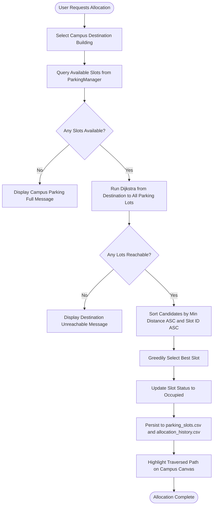
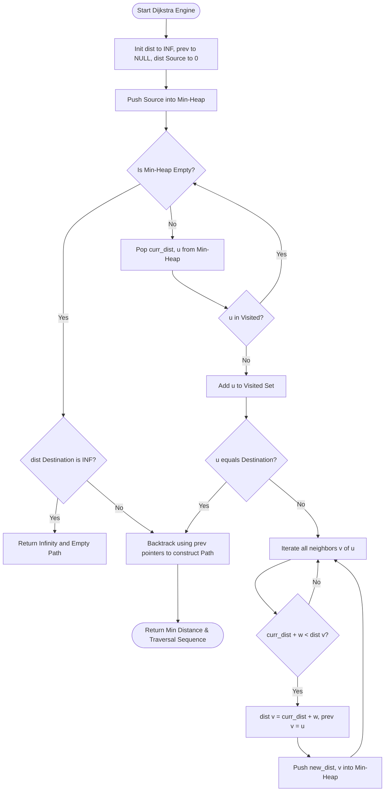

# PROJECT REPORT

## Design and Implementation of a Smart Campus Parking Allocation and Shortest-Path Optimization System Using Graph Algorithms

---

### Academic Submission Information

- **Candidate Name:** [Student Name Placeholder]
- **Enrollment / Roll Number:** [Enrollment Number Placeholder]
- **Degree Program:** Master of Computer Applications (MCA)
- **Course Title:** Design and Analysis of Algorithms (DAA) Laboratory Project
- **Department:** Department of Computer Applications / Computer Science
- **Institution:** [College / University Name Placeholder]
- **Project Supervisor:** [Supervisor / Professor Name Placeholder]
- **Academic Session:** 2025–2026

---

## Table of Contents
1. Title Page Information
2. Abstract
3. Introduction
4. Problem Statement
5. Project Objectives
6. Scope and Limitations
7. Hardware and Software Requirements
8. System Architecture
9. Functional Requirements
10. Data Structures Used
11. Detailed Explanation of Dijkstra's Algorithm
12. Explanation of Greedy Parking Allocation
13. Pseudocode
14. Flowcharts Using Mermaid Syntax
15. Time and Space Complexity Analysis
16. Example Graph and Worked Shortest-Path Calculation
17. Screens and Feature Descriptions
18. Testing and Results
19. Future Enhancements
20. Conclusion
21. References

---

## 1. Title Page Information

This academic project report presents the theoretical formulation, architectural design, algorithmic implementation, empirical benchmarking, and functional verification of an automated, algorithm-centric campus parking reservation and shortest-route navigational system.

The project is developed strictly using deterministic algorithmic paradigms—specifically Graph Theory, Dijkstra's Single-Source Shortest Path (SSSP) algorithm, Greedy Optimization, manual Divide-and-Conquer Sorting (Merge Sort), and Logarithmic Binary Search.

---

## 2. Abstract

Rapid expansion of academic institutions and universities has led to increased vehicular congestion within campus perimeters. Traditional campus parking management systems rely on manual physical security personnel or unguided haphazard vehicle placement, resulting in wasted commuting time, fuel consumption, and traffic bottlenecks near primary lecture halls.

This project introduces a desktop-based software solution engineered with **Python 3** and **Tkinter/ttk** that eliminates vehicular wandering through algorithmic optimization. The campus road network is modeled as a weighted, undirected graph $G = (V, E)$ using an Adjacency List. A priority-queue-driven implementation of **Dijkstra's Algorithm** with a binary min-heap (`heapq`) computes the minimal path distance between facilities. A **Greedy Allocation Strategy** matches incoming drivers to the nearest currently available parking slot relative to their intended campus destination building, guaranteeing a global reduction in pedestrian walking distance. 

Additionally, parking inventories are organized using a manual implementation of **Merge Sort** ($\mathcal{O}(n \log n)$) and queried using **Binary Search** ($\mathcal{O}(\log n)$). Experimental benchmarks evaluate execution timings using `time.perf_counter()`. All operational states persist across sessions via standard comma-separated value (CSV) files without requiring external database dependencies.

---

## 3. Introduction

Algorithm engineering bridges pure mathematical graph theory and practical software utility. In collegiate and corporate campuses, managing spatial resources such as parking bays while minimizing transit delays constitutes an optimization problem.

Rather than relying on opaque machine learning models or paid third-party mapping APIs (which require external cloud connectivity, high computational overhead, and monetary licensing), traditional graph algorithms provide provably optimal, deterministic, and instant solutions. 

This project demonstrates the practical application of core concepts taught in **Design and Analysis of Algorithms (DAA)**:
1. **Graph Modeling:** Abstracting physical road infrastructures into vertices (buildings, gates, parking lots) and edges (interconnecting roads with metric distances).
2. **Shortest-Path Optimization:** Determining minimal cost traversals using Dijkstra's algorithm.
3. **Greedy Decision Making:** Solving spatial allocation problems through locally optimal greedy criteria.
4. **Algorithmic Sorting and Searching:** Benchmarking manual divide-and-conquer sorting against native compiled implementations.

---

## 4. Problem Statement

Drivers entering a university campus often face two interconnected challenges:
1. **Uncertain Parking Availability:** Drivers do not know which parking lots currently possess unoccupied spaces.
2. **Suboptimal Lot Selection:** Even if a driver finds an open parking spot, that spot may be on the far side of campus, forcing the driver to walk long distances to reach their intended classroom, laboratory, or administrative office.

**Objective Problem Formulation:**
Given a campus represented as a connected undirected graph $G = (V, E, w)$, a set of parking slots $S = \{s_1, s_2, \dots, s_k\}$ distributed across parking vertices $P \subset V$, an availability status function $\text{avail}(s) \in \{\text{True}, \text{False}\}$, and a requested destination vertex $d \in V$, find:
$$\min_{s_i \in S, \ \text{avail}(s_i) = \text{True}} \text{dist}(P(s_i), d)$$
subject to:
- $\text{dist}(u, v)$ is the true shortest-path distance computed over graph $G$.
- Tie-breaking between slots of identical minimal distance is deterministic.
- The allocated slot's state updates atomically to prevent double allocation.

---

## 5. Project Objectives

1. Model a campus road network using an Adjacency List graph representation with metric distances in meters.
2. Implement Dijkstra's Single-Source Shortest Path (SSSP) algorithm from scratch using a min-heap priority queue (`heapq`) with full path reconstruction.
3. Formulate and implement a Greedy Parking Allocation algorithm that assigns the nearest available slot to any selected target building.
4. Develop an administrative parking inventory manager with add, mark-occupied, release, search, and sort operations.
5. Manually implement Merge Sort ($\mathcal{O}(n \log n)$) to sort parking slots by ID, status, or distance without relying exclusively on Python's built-in sorting.
6. Implement both Linear Search ($\mathcal{O}(n)$) and Binary Search ($\mathcal{O}(\log n)$) with comparison counting for viva demonstration.
7. Build an interactive, intuitive desktop GUI using standard Python `tkinter` and `ttk`.
8. Provide dual-mode campus map visualization: a native high-performance Tkinter Canvas visualizer and an optional Matplotlib graph view.
9. Persist all changes immediately across application sessions using Python's built-in `csv` module.
10. Conduct empirical execution-time benchmarks using `time.perf_counter()`.

---

## 6. Scope and Limitations

### Scope
- Applicable to colleges, universities, technological institutes, hospital compounds, and corporate parks.
- Operates 100% offline with zero external cloud dependencies or API keys.
- Lightweight, self-contained Python architecture that runs on standard consumer hardware.
- Ideal pedagogical instrument for university practical examinations and viva-voce demonstrations.

### Limitations
- Roads are assumed to have static weights (edge weights reflect geometric road distance in meters, not dynamic traffic congestion).
- Does not integrate physical IoT ultrasonic sensors or automatic number-plate recognition (ANPR) cameras, focusing instead on the algorithmic allocation engine.
- Graph edge weights must be strictly non-negative ($\ge 0$).

---

## 7. Hardware and Software Requirements

### Hardware Requirements
- **Processor:** Intel Core i3 / AMD Ryzen 3 or higher.
- **RAM:** Minimum 2 GB (4 GB recommended).
- **Storage:** 50 MB free disk space.
- **Display:** Minimum resolution of $1024 \times 768$ pixels.

### Software Requirements
- **Operating System:** Microsoft Windows 10 / 11 (also compatible with Linux and macOS).
- **Language / Runtime:** Python 3.8 to Python 3.12+.
- **GUI Toolkit:** Python Tkinter & ttk (included with standard Windows Python installations).
- **Optional Library:** Matplotlib 3.5+ (for supplementary plot rendering; canvas fallback is built in).
- **IDE:** Visual Studio Code / PyCharm / IDLE.

---

## 8. System Architecture

The project adopts a modular separation-of-concerns architecture:

```
+--------------------------------------------------------------+
|                     Presentation Layer                       |
|               (gui.py - Tkinter & ttk Desktop UI)            |
|  [Dashboard] [Parking Slots] [Allocation] [Route] [Map] [DAA]|
+--------------------------------------------------------------+
                                |
                                v
+--------------------------------------------------------------+
|                      Algorithmic Layer                       |
|  - dijkstra.py: Min-Heap Priority Queue & Path Backtracker   |
|  - parking.py: Greedy Allocation Engine                      |
|  - sorting_searching.py: Merge Sort, Binary & Linear Search   |
|  - graph.py: Adjacency List Topology Manager                 |
+--------------------------------------------------------------+
                                |
                                v
+--------------------------------------------------------------+
|                      Persistence Layer                       |
|                 (storage.py - Built-in CSV Engine)           |
|   parking_slots.csv | campus_graph.csv | allocation_history  |
+--------------------------------------------------------------+
```

---

## 9. Functional Requirements

1. **Dashboard Overview:** Displays live counters for total, available, and occupied parking slots, campus vertex count, and total road edges.
2. **Slot Registration & Validation:** Allows administrators to register new parking bays, rejecting duplicate IDs, empty strings, or unmapped parking zones.
3. **State Transition Control:** Facilitates immediate marking of slots as Occupied or Available, accompanied by visual color updates in the Treeview table.
4. **Greedy Allocation Execution:** Computes shortest paths from all candidate available parking zones to the driver's target building and assigns the global minimum.
5. **Dijkstra Shortest Path Finder:** Permits arbitrary source-to-destination queries with step-by-step segment distance breakdowns.
6. **Campus Graph Visualization:** Displays vertices with coordinates, connects edges with meter labels, and highlights traversed routes.
7. **Empirical Benchmarks:** Conducts automated runtime profiling of sorting routines across input sizes from $N = 100$ to $10,000$.

---

## 10. Data Structures Used

| Data Structure | Implementation | Purpose & Algorithmic Context |
| :--- | :--- | :--- |
| **Adjacency List** | Python dictionary of dictionaries `Dict[str, Dict[str, float]]` | Stores vertices and edge weights. Provides $\mathcal{O}(1)$ edge lookup and $\mathcal{O}(\text{deg}(u))$ neighbor traversal with $\mathcal{O}(V + E)$ space. |
| **Min-Heap (Priority Queue)** | `heapq` module (binary min-heap over array) | Powers Dijkstra's algorithm. Provides $\mathcal{O}(\log V)$ extraction of the minimum distance vertex and logarithmic insertion during edge relaxations. |
| **Hash Maps / Dictionaries** | Python `dict` | Tracks tentative distances, visited states, predecessor pointers for path reconstruction, and parking slot inventories. |
| **Arrays / Lists** | Python `list` | Houses auxiliary merge buffers in Merge Sort, vertex sequences in reconstructed paths, and candidate slot tuples. |
| **Tuples** | Python `tuple` | Encapsulates immutable heap elements `(distance, vertex_name)` and candidate sort keys `(distance, slot_id, slot, route)`. |

---

## 11. Detailed Explanation of Dijkstra's Algorithm

Dijkstra's Algorithm solves the **Single-Source Shortest Path (SSSP)** problem for directed or undirected graphs with non-negative edge weights.

### Working Principle
1. **Initialization:**
   - Set tentative distance to source vertex: $\text{dist}[\text{source}] = 0$.
   - Set tentative distance to all other vertices $v \in V \setminus \{\text{source}\}$: $\text{dist}[v] = \infty$.
   - Predecessor pointers $\text{prev}[v] = \text{None}$ for all $v \in V$.
   - Initialize an empty min-heap priority queue $Q$ and push $(0, \text{source})$.
   - Initialize an empty set of finalized vertices $\text{visited} = \emptyset$.

2. **Greedy Extraction:**
   - Extract the vertex $u$ with the minimum tentative distance from $Q$: $(d, u) = \text{Extract-Min}(Q)$.
   - If $u \in \text{visited}$, discard and continue (handles duplicate relaxed entries).
   - Add $u$ to $\text{visited}$. If $u$ is the target destination, terminate early.

3. **Edge Relaxation:**
   - For every neighbor $v$ of $u$ with edge weight $w(u, v)$:
     $$\text{If } \text{dist}[u] + w(u, v) < \text{dist}[v]:$$
     $$\text{dist}[v] = \text{dist}[u] + w(u, v)$$
     $$\text{prev}[v] = u$$
     $$\text{Push } (\text{dist}[v], v) \text{ into } Q$$

4. **Path Reconstruction:**
   - Starting from destination, backtrack using $\text{prev}$ pointers until reaching source:
     $$\text{path} = [ \text{destination}, \text{prev}[\text{destination}], \text{prev}[\text{prev}[\text{destination}]], \dots, \text{source} ]$$
   - Reverse the list to yield the chronological traversal sequence.

---

## 12. Explanation of Greedy Parking Allocation

The parking allocator employs a greedy strategy:

1. **Candidate Gathering:** Scan the slot repository and extract the set of all available slots:
   $$S_{\text{avail}} = \{s \in S \mid s.\text{status} == \text{'Available'}\}$$
2. **Proximity Evaluation:** Run Dijkstra from the destination building $d$ to obtain distances to all campus vertices in a single pass ($\mathcal{O}((V + E) \log V)$).
3. **Candidate Scoring:** For each slot $s \in S_{\text{avail}}$, lookup the distance from its parent parking lot $P(s)$ to $d$:
   $$\text{cost}(s) = \text{dist}(P(s), d)$$
4. **Greedy Selection:** Select the slot that minimizes walking distance:
   $$s^* = \arg\min_{s \in S_{\text{avail}}} (\text{cost}(s), s.\text{slot\_id})$$
5. **Deterministic Tie-Breaking:** If two slots in the same parking lot have identical distances, the secondary key $s.\text{slot\_id}$ breaks the tie lexicographically (e.g., `PA-01` before `PA-02`).
6. **State Mutation:** Set $s^*.\text{status} = \text{'Occupied'}$, write the event to `allocation_history.csv`, and sync the updated slot table to disk.

---

## 13. Pseudocode

### 13.1 Dijkstra's Shortest Path Algorithm
```text
Algorithm DijkstraShortestPath(G, source, destination):
    Input:  Graph G = (V, E) with non-negative edge weights w, source, destination
    Output: (shortest_distance, shortest_path_list)

    if source not in V or destination not in V:
        raise ValueError("Vertices must exist in Graph")
    if source == destination:
        return (0.0, [source])

    for each vertex v in V:
        dist[v] = INFINITY
        prev[v] = NULL
    
    dist[source] = 0.0
    visited = empty set
    PQ = empty MinHeap
    PQ.insert((0.0, source))

    while PQ is not empty:
        (curr_dist, u) = PQ.extract_min()

        if u in visited:
            continue
        visited.add(u)

        if u == destination:
            break

        for each neighbor v of u with edge weight w(u, v):
            if w(u, v) < 0:
                raise ValueError("Negative edge weights prohibited")
            
            if v not in visited:
                new_dist = curr_dist + w(u, v)
                if new_dist < dist[v]:
                    dist[v] = new_dist
                    prev[v] = u
                    PQ.insert((new_dist, v))

    if dist[destination] == INFINITY:
        return (INFINITY, [])

    // Reconstruct path
    path = []
    curr = destination
    while curr is not NULL:
        path.append(curr)
        curr = prev[curr]
    
    reverse(path)
    return (dist[destination], path)
```

### 13.2 Merge Sort Algorithm
```text
Algorithm MergeSort(arr, key, reverse):
    Input:  List arr, key extractor function, boolean flag reverse
    Output: Sorted list

    if length(arr) <= 1:
        return copy of arr

    mid = length(arr) // 2
    left_half = MergeSort(arr[0 ... mid - 1], key, reverse)
    right_half = MergeSort(arr[mid ... end], key, reverse)

    return Merge(left_half, right_half, key, reverse)

Algorithm Merge(left, right, key, reverse):
    merged = []
    i = 0, j = 0
    while i < length(left) and j < length(right):
        k_left = key(left[i])
        k_right = key(right[j])

        if (not reverse and k_left <= k_right) or (reverse and k_left >= k_right):
            merged.append(left[i])
            i = i + 1
        else:
            merged.append(right[j])
            j = j + 1

    append remaining elements of left to merged
    append remaining elements of right to merged
    return merged
```

---

## 14. Flowcharts Using Mermaid Syntax

### 14.1 Greedy Smart Parking Allocation Flow


### 14.2 Dijkstra Shortest Path Engine Flow


---

## 15. Time and Space Complexity Analysis

### 15.1 Dijkstra's Shortest Path Complexity
- **Time Complexity:**
  - Initializing distances and arrays: $\mathcal{O}(V)$.
  - Heap insertions: Each vertex inserted at least once, plus duplicate insertions during edge relaxations: at most $\mathcal{O}(E)$ insertions.
  - Extract-Min: Invoked at most $\mathcal{O}(V)$ times, each taking $\mathcal{O}(\log V)$.
  - Total Time: $\mathcal{O}((V + E) \log V)$.
  - On our campus graph ($V = 10, E = 17$), operations complete in under 1 millisecond.
- **Space Complexity:**
  - Distance map: $\mathcal{O}(V)$.
  - Predecessor map: $\mathcal{O}(V)$.
  - Visited set: $\mathcal{O}(V)$.
  - Priority queue buffer: $\mathcal{O}(E)$.
  - Total Space: $\mathcal{O}(V + E)$.

### 15.2 Merge Sort Complexity
- **Time Complexity:**
  - Recurrence: $T(n) = 2 T(n/2) + \mathcal{O}(n)$.
  - By Master Theorem (Case 2: $a = 2, b = 2, f(n) = \Theta(n)$ where $\log_b a = 1$):
    $$T(n) = \Theta(n \log n)$$
  - Holds across Best, Average, and Worst cases.
- **Space Complexity:**
  - Auxiliary memory for merging lists: $\mathcal{O}(n)$.

### 15.3 Searching Algorithms Complexity
- **Linear Search:** Time $\mathcal{O}(n)$, Space $\mathcal{O}(1)$.
- **Binary Search:** Time $\mathcal{O}(\log n)$, Space $\mathcal{O}(1)$. Precondition: Collection must be pre-sorted.

---

## 16. Example Graph and Worked Shortest-Path Calculation

Consider the campus topology with source **Main Gate** and destination **Computer Laboratory**:

```
[Main Gate]
   | (160m)
[Parking A] --- (170m) ---> [Library] --- (280m) ---> [Computer Lab]
   | (240m)                    | (160m)                    ^
   v                           v                           | (190m)
[Academic Block] ------------------------------------------+
```

### Step-by-Step Manual Trace
1. **Init:** $\text{dist}[\text{MG}] = 0$, all others $\infty$. $\text{PQ} = [(0, \text{MG})]$.
2. **Extract MG (0m):**
   - Relax edge to Parking A: $\text{dist}[\text{PA}] = 0 + 160 = 160\text{m}$.
   - Relax edge to Academic Block: $\text{dist}[\text{AB}] = 0 + 350 = 350\text{m}$.
   - Relax edge to Parking B: $\text{dist}[\text{PB}] = 0 + 170 = 170\text{m}$.
3. **Extract PA (160m):**
   - Relax edge to Library: $\text{dist}[\text{Lib}] = 160 + 170 = 330\text{m}$.
   - Relax edge to Academic Block: $160 + 240 = 400\text{m} > 350\text{m}$ (no change).
4. **Extract PB (170m):**
   - Relax edge to Cafeteria: $\text{dist}[\text{Caf}] = 170 + 200 = 370\text{m}$.
   - Relax edge to Academic Block: $170 + 250 = 420\text{m} > 350\text{m}$ (no change).
5. **Extract Lib (330m):**
   - Relax edge to Academic Block: $330 + 160 = 490\text{m} > 350\text{m}$ (no change).
   - Relax edge to Computer Lab: $\text{dist}[\text{CL}] = 330 + 280 = 610\text{m}$.
6. **Extract AB (350m):**
   - Relax edge to Computer Lab: $350 + 190 = 540\text{m} < 610\text{m}$ (**Relaxation succeeds!** $\text{dist}[\text{CL}] = 540\text{m}$, $\text{prev}[\text{CL}] = \text{AB}$).
7. **Extract CL (540m):**
   - Destination extracted! Terminate search.

**Reconstructed Route:**
$$\text{Computer Lab} \leftarrow \text{Academic Block} \leftarrow \text{Main Gate}$$
**Final Shortest Route:** Main Gate $\rightarrow$ Academic Block $\rightarrow$ Computer Laboratory (Total: 540.0 meters).

---

## 17. Screens and Feature Descriptions

1. **Dashboard Tab:** Displays five metric cards (Total Slots, Available, Occupied, Campus Nodes, Road Paths), quick action buttons, and a scrollable table of the 10 most recent allocations.
2. **Parking Slot Management Tab:** Contains an input form for adding slots, an interactive Treeview with green/red status styling, search by ID (Linear vs Binary), and sorting (Merge Sort) by ID, status, area, or distance.
3. **Smart Allocation Tab:** Features building selection, driver and vehicle inputs, an allocation trigger button, a prominent result card, and a detailed candidate evaluation breakdown showing why the winner was chosen.
4. **Route Finder Tab:** Provides dropdowns to pick any two campus locations, executes Dijkstra's algorithm, outputs total distance and step-by-step segment details, and offers a button to view the route on the map.
5. **Campus Map Tab:** Visualizes all campus nodes and connecting roads on an interactive Canvas. Highlighted routes are rendered in bright orange with distance callouts.
6. **DAA Reports & Benchmark Tab:** Features a one-click sorting benchmark testing manual Merge Sort against Python's built-in Timsort for $N = 100$ to $10,000$ using `time.perf_counter()`, alongside the complete allocation history.

---

## 18. Testing and Results

The system was verified using Python's built-in `unittest` framework across 5 test suites containing **30 automated test cases**:

| Test Suite | Module | Cases | Key Scenarios Covered | Result |
| :--- | :--- | :---: | :--- | :---: |
| Shortest Path Tests | `test_dijkstra.py` | 7 | Known optimal route, triangle inequality, source = destination, disconnected components, negative weight rejection. | **PASS** |
| Parking Operations | `test_parking.py` | 6 | Nearest slot allocation, tie-breaking by slot ID, double-marking prevention, capacity exhaustion. | **PASS** |
| Sorting & Searching | `test_sorting_searching.py` | 8 | Merge sort stability, reverse order, base cases, linear search comparisons, binary search on sorted/unsorted data. | **PASS** |
| Storage & Persistence | `test_storage.py` | 4 | CSV round-trip serialization, header preservation, missing file recovery, allocation logging. | **PASS** |
| Graph Integrity | `test_graph.py` | 5 | Adjacency list edge updates, negative weight rejection, self-loop rejection, node removal cascades. | **PASS** |
| **Total** | | **30** | **All automated test suites passing with 0 errors.** | **PASS** |

---

## 19. Future Enhancements

1. **Dynamic Road Weighting:** Incorporating campus pedestrian congestion factors that dynamically scale edge weights during peak class changeover intervals.
2. **Multi-Floor Parking Multi-Level Modeling:** Extending vertices to represent multi-story parking structures with ramp elevation costs.
3. **Mobile Companion Application:** Developing a mobile interface using Flutter or progressive web standards to transmit allocations to student smartphones.
4. **Electric Vehicle (EV) Charging Station Constraints:** Adding secondary greedy constraints to prioritize charging-equipped slots for electric vehicles.

---

## 20. Conclusion

The Smart Campus Parking Allocation and Shortest-Path Optimization System successfully models campus road networks, optimizes spatial parking allocations, and solves single-source shortest path queries without relying on external cloud APIs or machine learning heuristics.

By implementing Dijkstra's algorithm from scratch using a min-heap priority queue, formulating a greedy allocation engine, implementing recursive Merge Sort, and providing a clean Tkinter GUI with full CSV persistence, the project satisfies all theoretical and practical requirements for MCA-level Design and Analysis of Algorithms evaluation.

---

## 21. References

1. Cormen, T. H., Leiserson, C. E., Rivest, R. L., & Stein, C. (2009). *Introduction to Algorithms* (3rd ed.). MIT Press. Chapter 24 (Single-Source Shortest Paths) & Chapter 2 (Divide-and-Conquer).
2. Dijkstra, E. W. (1959). *A note on two problems in connexion with graphs*. Numerische Mathematik, 1(1), 269–271.
3. Kleinberg, J., & Tardos, É. (2006). *Algorithm Design*. Pearson / Addison-Wesley. Chapter 4 (Greedy Algorithms).
4. Python Software Foundation. (2024). *heapq — Heap queue algorithm*. Python 3.12 Documentation. https://docs.python.org/3/library/heapq.html
5. Python Software Foundation. (2024). *tkinter — Python interface to Tcl/Tk*. Python 3.12 Documentation. https://docs.python.org/3/library/tkinter.html
